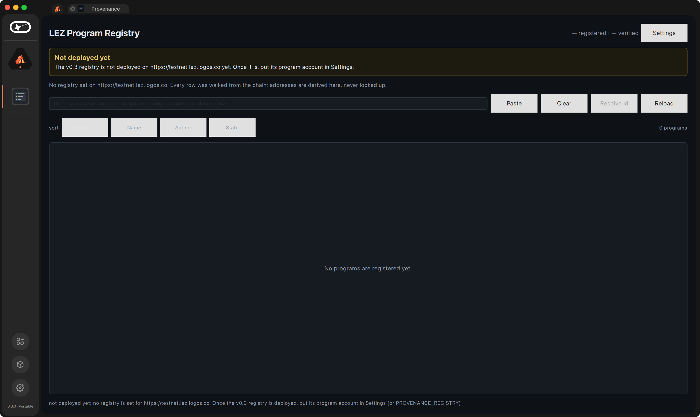
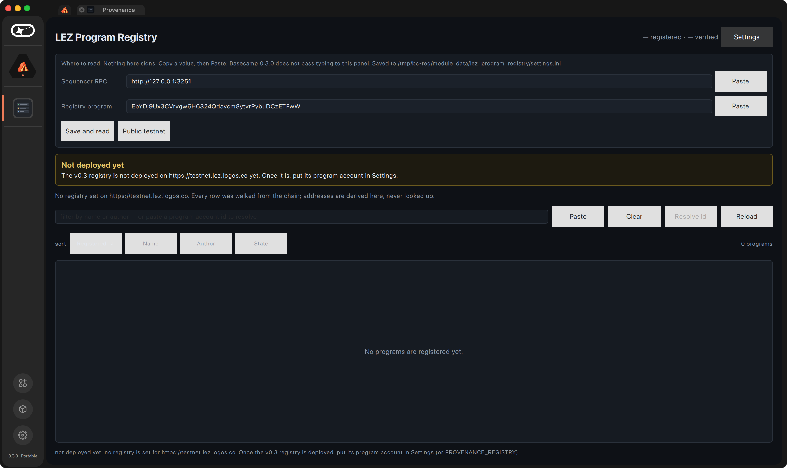
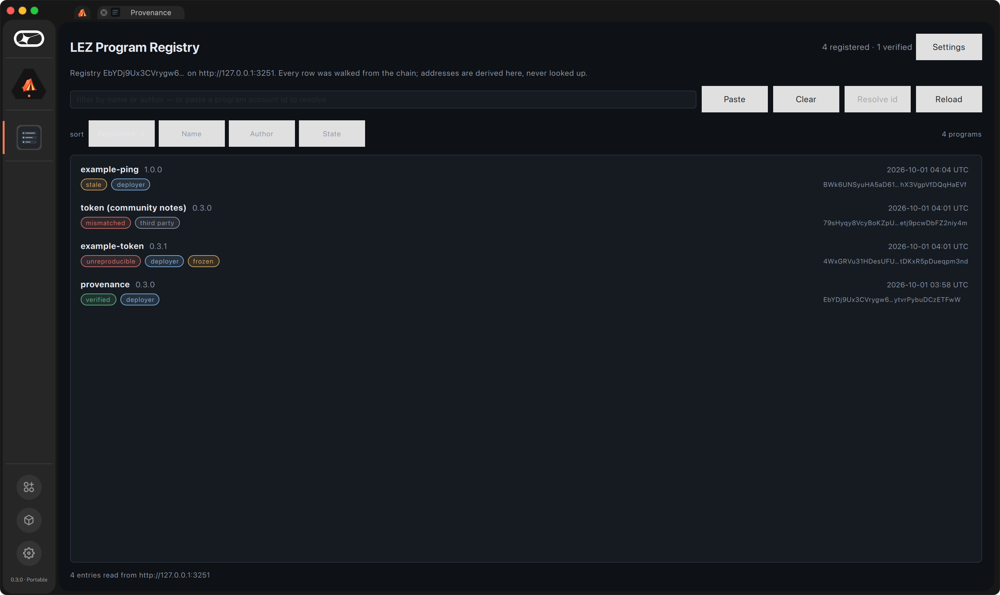
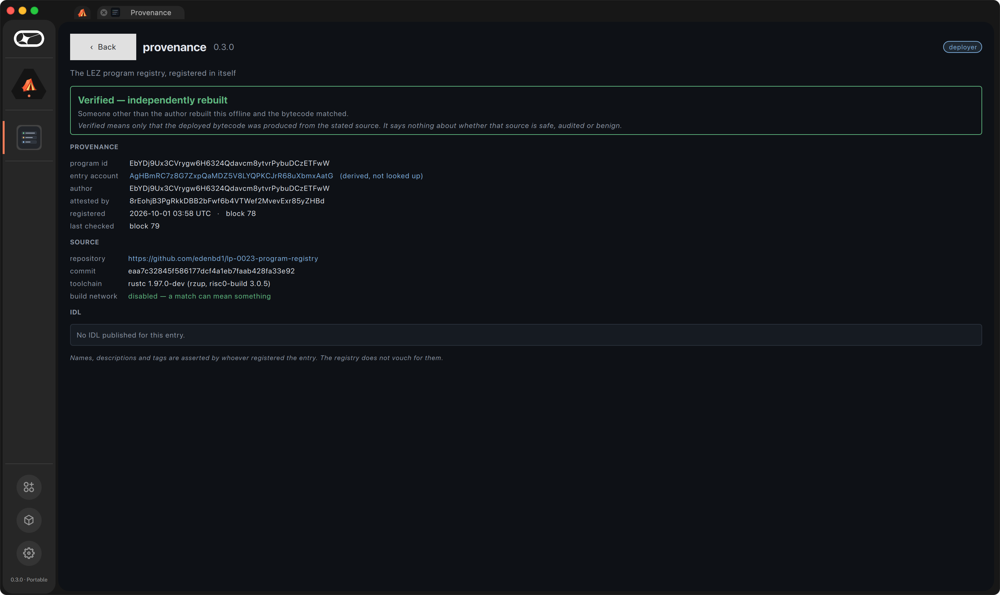
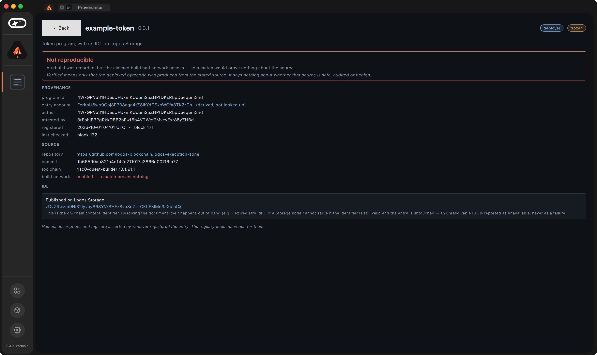

# Basecamp module

A registry browser for LogosBasecamp. Type a program id; the panel **derives**
where that program's entry lives and reads it from a sequencer.

The derived address is shown before the answer arrives, and that is the whole
argument on screen: nothing was asked of an index that could omit a program,
serve a stale answer, or go down separately from the chain. Two SHA-256 hashes,
computed in the panel.

It holds no keys and signs nothing.

## What it shows that a tick would not

`Verified` is not one colour here. A build whose only voucher is its own author
renders differently from one a third party reproduced, because those are
different claims and painting both green hides the difference that matters most.
`Unreproducible` says why: the claimed build had network access, so a match
would prove nothing about the source.

## Which registry, which chain

LEZ v0.3: the panel reads the registry program's shard of each account
(`getAccount` → `data.shards[<registry>]`), and a program id is its header
account, typed as base58 or as 64 hex characters.

Both are settings: the sequencer RPC (default `https://testnet.lez.logos.co`)
and the registry program account (empty until the v0.3 registry is deployed on
the public testnet, and the panel says "Not deployed yet" rather than resolving
every program to "not registered"). They are saved to
`$LOGOS_USER_DIR/module_data/lez_program_registry/settings.ini`, so a throwaway
`--user-dir` never touches another instance's. `LEZ_RPC` and
`PROVENANCE_REGISTRY` override them.



## In Basecamp 0.3.0, against a local v0.3 sequencer

`KEEP=1 scripts/e2e-v03-local.sh` leaves its LEZ v0.3.0 sequencer (tag
`v0.3.0`, commit `db66590ab`, standalone) running with four entries in the
registry. Pointed at it, the panel walks all four and shows each verdict as the
lifecycle left it (verified, unreproducible and frozen, mismatched, stale):





A pasted program id resolves by derivation: the entry account the panel derives
for the token program, `FerkbU6w…TKZrCh`, is the one the SDK's resolve example
prints for it in the same run.



**Typing does not reach the panel in Basecamp 0.3.0.** Clicks do, keys do
not: Basecamp keeps keyboard activation on its own window, and a legacy `ui`
widget module never receives the key events (Basecamp's own search field types
fine). So the lookup field and both settings fields have a Paste button that
reads the clipboard: copy a program id, click Paste, then Resolve id.

To reproduce on a throwaway Basecamp instance, never your own:

```bash
nix build ./app#lgx-portable --accept-flake-config -o result
scripts/install-local.sh /tmp/bc-provenance result/*.lgx
~/Applications/LogosBasecamp-0.3.0.app/Contents/MacOS/LogosBasecamp --user-dir /tmp/bc-provenance
```

## Build

```bash
export PATH=/nix/var/nix/profiles/default/bin:$PATH
nix build ./app#lgx-portable --accept-flake-config -o result   # from the repo root
```

logos-module-builder (`mkLogosModule`, see [`flake.nix`](flake.nix)), pinned to
the revision the Basecamp 0.3.0 catalog modules are built with. Its Qt is
6.9.2, the version Basecamp bundles, and that version is a ceiling: a plugin
built against a newer minor is rejected at load. The dylib references Qt as
`@rpath/…`, which resolves against Basecamp's own frameworks. The QML is
compiled in with zlib rather than zstd, since a zstd resource needs a QtCore
built with zstd and not every Qt 6.9.2 is. CI builds the package on
ubuntu-24.04 (`linux-amd64`) and macos-14 (`darwin-arm64`), runs the load
harness ([`tests/ui_plugin_load_test.cpp`](tests/ui_plugin_load_test.cpp)) on
the packaged macOS dylib, and merges both variants into one `.lgx`.

## Load-verified, not just compiled

A plugin that compiles and does not load is the failure that matters, and it is
invisible without checking. Both the build output and the binary **extracted from
the packaged `.lgx`** were loaded through `QPluginLoader` and cast to
`IComponent`, exactly as Basecamp does:

```
IID           : com.logos.component.IComponent
className     : RegistryPlugin
instance      : loaded
IComponent    : cast succeeded
```

`IComponent`'s vtable is exactly three entries — destructor, `createWidget`,
`destroyWidget`. An extra virtual shifts every later slot and the host calls the
wrong function through a correctly cast pointer, so `src/plugin.h` mirrors it
slot for slot rather than approximating it.

The packaged manifest carries `type: "ui"`, written by the builder's bundler
from `metadata.json`; an empty type would make the module invisible in Basecamp,
and CI asserts it.

## Two things that only show up with the host actually running

**A module that loads can still kill Basecamp.** `QPluginLoader::load()`
returning true proves the binary is ABI-compatible and exports the interface. It
proves nothing about using it. Clicking the tile killed the host with `SIGTRAP` —
no dialog, no log line, the window simply gone:

```
libsystem_pthread.dylib  pthread_jit_write_protect_np
libpcre2-16.0.dylib      sljit_malloc_exec / pcre2_jit_compile_16
QtCore                   QRegularExpressionPrivate::compilePattern()
QtNetwork                macQueryInternal(QNetworkProxyQuery const&)
QtNetwork                QNetworkProxyFactory::systemProxyForQuery(...)
```

The first `QNetworkAccessManager` request triggers Qt's macOS system-proxy
lookup, which builds a `QRegularExpression`, which asks PCRE2 to JIT-compile it.
Basecamp runs under the hardened runtime *without*
`com.apple.security.cs.allow-jit`, so the JIT allocation traps. A module cannot
add an entitlement to somebody else's signed binary, so it declines the lookup
instead — two lines in the bridge constructor, before any request:

```cpp
QNetworkProxyFactory::setUseSystemConfiguration(false);
m_net.setProxy(QNetworkProxy::NoProxy);
```

**And two modules that both register `qrc:/qml/Main.qml` render each other.** Qt's
resource system is process-global, so whichever registers first wins for both:
with two of these installed, one tile showed the other module's UI over its own
live data. The resource prefix is now this module's own name, which cannot
collide. Verified with five modules installed at once, each opened in turn.

Neither failure appears in a load test. Both appear on the first click.
